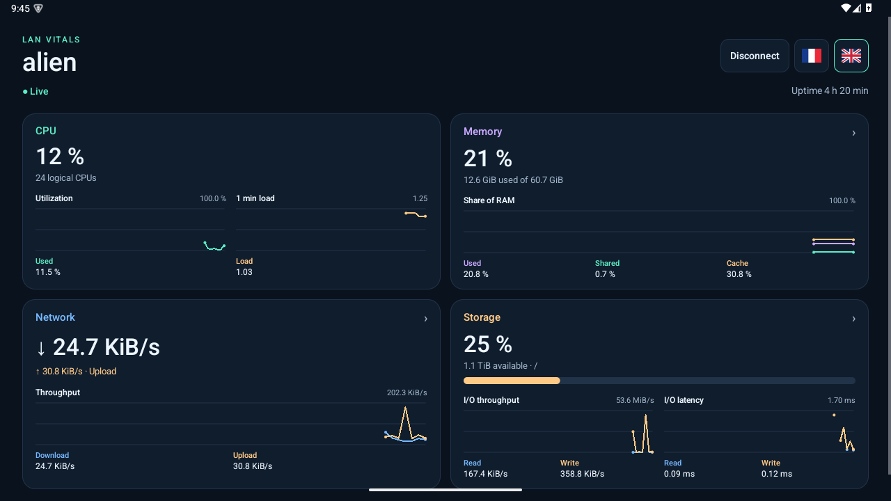
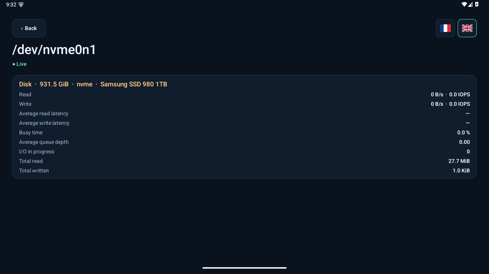

# LAN Vitals

[Documentation en français](README.md)

An Android dashboard for monitoring a Linux PC on the same local network. Metrics refresh about once a second. On tablets, the dashboard uses two columns when the screen is wide enough.

## Getting started

1. Download the Linux server and signed APK from [Releases](https://github.com/amapi/lan-vitals/releases). The server uses Python 3.7 or later, OpenSSL 1.1.1 or later, `ip` (iproute2), and `lsblk` (util-linux). The APK requires Android 6.0 or later.
2. On the PC, start the server with your password.

   ```bash
   python3 lan-vitals-server --password 'your-password'
   ```

   To keep the password out of shell history and process arguments, use this alternative.

   ```bash
   (read -rs -p 'LAN Vitals password: ' LAN_VITALS_PASSWORD
    printf '\n'
    export LAN_VITALS_PASSWORD
    python3 lan-vitals-server)
   ```

3. Connect the tablet to the same IPv4 network as the PC. Install and open LAN Vitals, enter the same password, and tap **Find the server**.
4. During first pairing, compare the fingerprint on the tablet with the one in the PC terminal. Confirm the match to allow the app to send the password.

Use the 🇫🇷 and 🇬🇧 flags to switch the app language immediately. The client remembers the language and, after authentication, the password encrypted with an Android Keystore key. It reconnects automatically on launch. Use **Disconnect** to return to the sign-in screen and **Forget pairing** to clear the saved password and fingerprint.

## Server configuration

Before announcing startup, the server checks its dependencies, access to `/proc`, metrics collection, the TLS identity, and whether it can open its ports. It lists missing commands with their package names and reports the failing step if a check fails.

After a successful start, the server saves its settings to `$XDG_CONFIG_HOME/lan-vitals/config.json` or, by default, `~/.config/lan-vitals/config.json`. It creates this private file with mode `0600`. The file contains a salted PBKDF2-SHA-256 verifier. Start the server without arguments to reuse the default configuration. Command-line options override saved settings. For the password, `--password` takes precedence over `LAN_VITALS_PASSWORD`, which takes precedence over the configuration.

| Option | Effect |
| --- | --- |
| `--lang fr` or `--lang en` | Sets the server help and message language. Defaults to French. |
| `--config path` | Selects a different file. Repeat this option on restart to reuse that file. |
| `--bind 192.168.1.10` | Restricts TCP listening and permitted clients to this address and its subnet. |
| `--port 48323` | Changes the TCP port advertised to clients. Defaults to `48322`. |
| `--disk /mnt/data` | Selects the filesystem summarised on the **Storage** card. Defaults to `/`. |
| `--state-dir path` | Changes the TLS identity directory. Defaults to `~/.local/state/lan-vitals` or a directory under `$XDG_STATE_HOME`. |

The TLS identity stays in `identity.pem`. If the server identity changes, forget the pairing on the client and verify the new fingerprint. Discovery uses UDP port **48321**. The PC can use Ethernet and the tablet Wi-Fi if they share the same subnet. If discovery fails, check the PC firewall and Wi-Fi client isolation.

## Metrics

- **CPU** plots utilization and the Linux 1-minute load average on separate scales.
- **Memory** plots used RAM (`MemTotal − MemAvailable`), shared memory (`Shmem`), and cache (`Cached`) as a percentage of total RAM. Some values overlap. Tap the card to see free and available RAM, buffers, kernel memory, pages pending writeback, and swap.
- **Network** opens all Linux interfaces, including virtual, loopback, and inactive interfaces. Each card shows link status, addresses, MTU, rates, and cumulative counters. The dashboard card aggregates active broadcast-capable IPv4 interfaces allowed by the configuration.
- **Storage** shows space on the filesystem selected by `--disk` alongside machine-wide read and write throughput and latency. The I/O charts aggregate whole disks to avoid counting partitions twice. Latencies are weighted by IOPS, and the chart has a gap when no operations complete. Tap the card for the block device inventory, then tap a device for its throughput, IOPS, latency, busy time, queue depth, and cumulative counters.

Charts retain up to 60 samples. Detail pages and the shared-memory, cache, and disk I/O charts require server 0.2 or later. The basic dashboard remains compatible with version 0.1.

## Screenshots

### Dashboard



### Disk details



## Building and testing

Install JDK 17, Android SDK Platform 36, Android Build Tools 36.0.0, and `zip`. The client uses native Android views.

```bash
keytool -genkeypair -alias lan-vitals -keyalg RSA -keysize 3072 \
  -validity 10000 -dname 'CN=LAN Vitals' -storetype PKCS12 -keystore lan-vitals.p12
export ANDROID_HOME=/path/to/android-sdk
export LAN_VITALS_KEYSTORE=/path/to/lan-vitals.p12
export LAN_VITALS_KEYSTORE_PASSWORD_FILE=/path/to/password-file
android/build.sh
python3 tests/smoke.py
```

Put the keystore password on the first line of the password file. Keep both files outside the repository and reuse the same key for upgrades. The test requires an active IPv4 interface. It checks discovery, the TLS stream, configuration across restarts, and metrics including disk I/O calculations.
