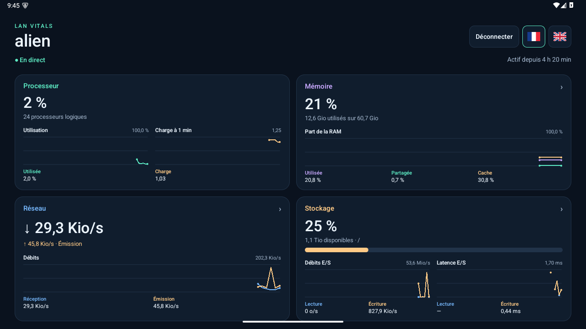
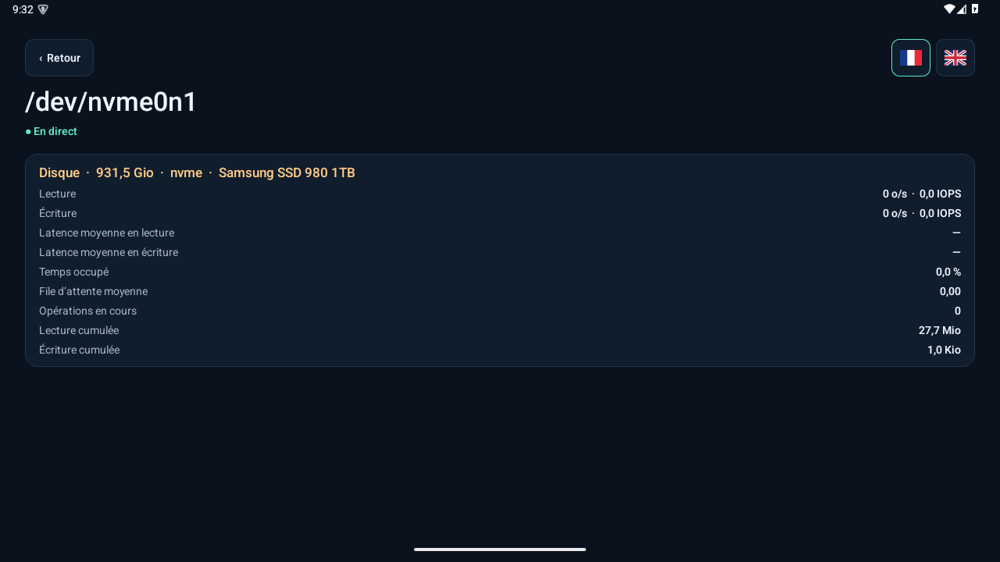

# LAN Vitals

[English documentation](README.en.md)

Tableau de bord Android pour suivre un PC Linux sur le même réseau local. Les mesures sont actualisées environ chaque seconde. Sur tablette, le tableau de bord passe à deux colonnes lorsque l’écran est assez large.

## Démarrage

1. Téléchargez le serveur Linux et l’APK signé depuis [Releases](https://github.com/amapi/lan-vitals/releases). Le serveur utilise Python 3.7 ou ultérieur, OpenSSL 1.1.1 ou ultérieur, `ip` (iproute2) et `lsblk` (util-linux). L’APK requiert Android 6.0 ou ultérieur.
2. Sur le PC, lancez le serveur avec votre mot de passe.

   ```bash
   python3 lan-vitals-server --password 'votre-mot-de-passe'
   ```

   Pour éviter que le mot de passe apparaisse dans l’historique du shell ou les arguments du processus, utilisez cette variante.

   ```bash
   (read -rs -p 'Mot de passe LAN Vitals : ' LAN_VITALS_PASSWORD
    printf '\n'
    export LAN_VITALS_PASSWORD
    python3 lan-vitals-server)
   ```

3. Connectez la tablette au même réseau IPv4 que le PC. Installez et ouvrez LAN Vitals, puis saisissez le même mot de passe et touchez **Trouver le serveur**.
4. Au premier appairage, comparez l’empreinte sur la tablette à celle du terminal du PC. Confirmez la correspondance pour autoriser l’envoi du mot de passe.

Les drapeaux 🇫🇷 et 🇬🇧 changent la langue de l’application immédiatement. Le client mémorise la langue et, après authentification, le mot de passe chiffré avec une clé Android Keystore. Il se reconnecte automatiquement au lancement. Utilisez **Déconnecter** pour revenir à l’écran de connexion et **Oublier l’appairage** pour effacer le mot de passe et l’empreinte mémorisés.

## Configuration du serveur

Avant d’annoncer son démarrage, le serveur vérifie ses dépendances, l’accès à `/proc`, la collecte des métriques, l’identité TLS et l’ouverture des ports. Il liste les commandes manquantes avec leurs noms de paquet et indique l’étape en cause si un contrôle échoue.

Après un démarrage réussi, le serveur enregistre ses paramètres dans `$XDG_CONFIG_HOME/lan-vitals/config.json` ou, par défaut, `~/.config/lan-vitals/config.json`. Ce fichier privé est créé avec le mode `0600`. Il contient un vérificateur salé PBKDF2-SHA-256 et aucun mot de passe en clair. Relancez le serveur sans argument pour réutiliser la configuration par défaut. Une option fournie sur la ligne de commande remplace la valeur mémorisée. Pour le mot de passe, `--password` est prioritaire sur `LAN_VITALS_PASSWORD`, qui est prioritaire sur la configuration.

| Option | Effet |
| --- | --- |
| `--lang fr` ou `--lang en` | Langue de l’aide et des messages du serveur. Français par défaut. |
| `--config chemin` | Sélectionne un autre fichier. Répétez cette option au redémarrage pour réutiliser ce fichier. |
| `--bind 192.168.1.10` | Limite l’écoute TCP et les clients autorisés à cette adresse et son sous-réseau. |
| `--port 48323` | Modifie le port TCP annoncé aux clients. Par défaut, `48322`. |
| `--disk /mnt/data` | Sélectionne le système de fichiers résumé dans la carte **Stockage**. Par défaut, `/`. |
| `--state-dir chemin` | Modifie le dossier de l’identité TLS. Par défaut, `~/.local/state/lan-vitals`, ou sous `$XDG_STATE_HOME`. |

L’identité TLS reste dans `identity.pem`. En cas de changement d’identité du serveur, effacez l’appairage côté client et vérifiez la nouvelle empreinte. La découverte utilise le port UDP **48321**. Le PC peut être en Ethernet et la tablette en Wi-Fi s’ils partagent le même sous-réseau. Si la découverte échoue, vérifiez le pare-feu du PC et l’isolation des clients du réseau Wi-Fi.

## Métriques

- **Processeur** affiche le pourcentage d’utilisation et la charge moyenne Linux à 1 minute sur deux échelles distinctes.
- **Mémoire** trace la RAM utilisée (`MemTotal − MemAvailable`), la mémoire partagée (`Shmem`) et le cache (`Cached`) en pourcentage de la RAM totale. Certaines valeurs se recouvrent. Touchez la carte pour voir la RAM libre et disponible, les tampons, la mémoire noyau, les pages en attente d’écriture et le swap.
- **Réseau** ouvre toutes les interfaces Linux, y compris les interfaces virtuelles, la boucle locale et les interfaces inactives. Chaque fiche indique l’état de la liaison, les adresses, le MTU, les débits et les compteurs cumulés. La carte du tableau de bord cumule les interfaces IPv4 de diffusion actives autorisées par la configuration.
- **Stockage** affiche l’espace du système de fichiers sélectionné par `--disk` et les débits et latences de lecture et d’écriture de la machine. Les courbes d’E/S agrègent les disques entiers pour éviter le double comptage des partitions. Les latences sont pondérées par les IOPS et la courbe présente une interruption en l’absence d’opération terminée. Touchez la carte pour ouvrir l’inventaire des périphériques bloc, puis un périphérique pour voir ses débits, IOPS, latences, temps occupé, profondeur de file et compteurs cumulés.

Les courbes conservent jusqu’à 60 relevés. Les pages détaillées et les courbes de mémoire partagée, de cache et d’E/S disque nécessitent le serveur 0.2 ou ultérieur. Le tableau de bord de base reste compatible avec la version 0.1.

## Captures d’écran

### Tableau de bord



### Détail d’un disque



## Compilation et tests

Installez un JDK 17, Android SDK Platform 36, Android Build Tools 36.0.0 et `zip`. Le client utilise les vues Android natives.

```bash
keytool -genkeypair -alias lan-vitals -keyalg RSA -keysize 3072 \
  -validity 10000 -dname 'CN=LAN Vitals' -storetype PKCS12 -keystore lan-vitals.p12
export ANDROID_HOME=/chemin/vers/android-sdk
export LAN_VITALS_KEYSTORE=/chemin/vers/lan-vitals.p12
export LAN_VITALS_KEYSTORE_PASSWORD_FILE=/chemin/vers/fichier-mot-de-passe
android/build.sh
python3 tests/smoke.py
```

Le fichier de mot de passe contient celui du keystore sur sa première ligne. Conservez les deux fichiers hors du dépôt et réutilisez la même clé pour les mises à jour. Le test nécessite une interface IPv4 active. Il vérifie la découverte, le flux TLS, la configuration au redémarrage et les métriques, notamment le calcul des E/S disque.
